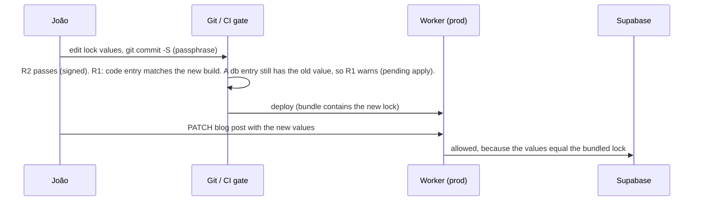

# PRD-seo-lock-approval-gate — SEO lock with signed-commit approval

**Status:** IN PROGRESS — local checks running; owner signing and deployed CI evidence remain open
**Priority:** P1 — no gate exists today: any agent (Claude Code, Codex, Hermes cron) can change a page that earns traffic and update its test in the same commit (AC-1 to AC-6 open).
**Complexity:** 7 → HIGH; risk override: none (breakdown: 6 implementation files +2, new module +2, crosses the CI deploy boundary +2, GitHub API +1)
**Owner:** SEO dev agent; João owns the signing key and every lock value change.
**Depends on:** None. Followed by [PRD-seo-lock-monitoring](seo-lock-monitoring.md) and [PRD-pseo-split-testing](pseo-split-testing.md).

## Context
Principle (João, 2026-10-23): "let your winners run, cut your losses quickly." Pages that earn traffic must not change unless João approves. Each approved change is a small bet with a stop-loss (the stop-loss is in PRD-seo-lock-monitoring).

Facts checked on 2026-10-23:
- ❌ `master` has no branch protection (`gh api .../branches/master/protection` → 404).
- ❌ All agents commit as João. 49 of the last 50 commits are unsigned.
- ✅ The `gh` token scopes are `gist, read:org, repo, workflow`. They do not include `admin:ssh_signing_key`, so agents cannot register a new signing key.
- ✅ `.github/workflows/deploy.yml` deploys on push to `master` (job `deploy`, `npx next build --webpack` at line 92). `yarn deploy` (`scripts/deploy/deploy.sh`) can also deploy locally.
- ✅ Blog posts are in Supabase. Agents change them through `PATCH /api/blog/posts/[slug]` (`app/api/blog/posts/[slug]/route.ts:63`, `x-api-key` auth).
- ⚠️ `tests/unit/seo/` has 144 files. About 1,130 lines (13 files) are per-edit pins, one test per change (list in Phase 3). Each new edit adds a regex test, and an agent can change both the page and its pin.
- Precedent for a generated, committed SEO artifact: `content/seo-equity.json` (generator `scripts/seo/generate-seo-equity-snapshot.ts`).
- Industry practice (from memory, not verified today): pre-deploy crawl diff (Lumar Protect, Screaming Frog compare) and field-level edit permissions. This PRD covers both layers. The signed commit replaces the CMS role, because our editors are agents with João's credentials.

## Solution
Three parts. Each part sits at a choke point that every tool must go through.

1. **Lock.** `content/seo-lock.json` holds one entry for each URL with more than 20 GSC clicks in 28 days. The set includes locale URLs. Each entry stores normalized fields: `title`, `description`, `h1`, `introHash` (SHA-256 of the normalized first paragraph), `canonical`, `robots`, `hreflang` (sorted list), `jsonLdTypes` (sorted list), plus `source: "code" | "db"` and `clicks28d`. `yarn seo:lock:regen` makes it from GSC data (local key, read-only) and rendered HTML.
2. **Deploy gate.** `scripts/seo/seo-lock-gate.ts` runs after `next build` in the `deploy.yml` deploy job and in `deploy.sh`. It applies two rules:
   - **R1 render:** it starts the built app, fetches each locked path, extracts the fields with the same normalizer, and fails on any mismatch.
   - **R2 approval:** let S be the newest commit that touched the lock and has an SSH signature that verifies against João's GitHub SSH signing keys (public `GET /users/jonit-dev/ssh_signing_keys` → temp `allowed_signers` → `git verify-commit`). Every later commit that touches the lock must be additions-only: no entry removed and no existing value changed.
3. **Blog API gate.** `PATCH /api/blog/posts/[slug]` rejects a change to a locked field of a locked slug with 409, unless the new value equals the lock value in the deployed bundle.

The approved-change flow (for example, a January title change from "2026" to "2027"):

Shared code: `lib/seo/seo-lock.ts` (types, `extractSeoFields(html)`, `normalize`, `diffLock`) is used by the regen script, the gate and the blog route. The blog route uses only the lock lookup, not HTML parsing (10ms CPU limit).

Signing setup (owner): a dedicated ed25519 key with a passphrase, registered on GitHub as a signing key only. The key stays out of `ssh-agent` and the desktop keyring. João signs lock commits with `git commit -S`. Normal commits stay unsigned (`commit.gpgsign=false`).

## Acceptance Criteria
- [x] AC-1 [local]: `yarn seo:lock:regen` writes `content/seo-lock.json` with every URL that has more than 20 clicks in 28 days, and each entry has all 8 fields. proof: `yarn seo:lock:regen && yarn vitest run tests/unit/seo/seo-lock.unit.spec.ts` (schema + entry count equal to the GSC rows above the threshold) — Evidence: Default GSC-fetching CLI `yarn seo:lock:regen --output=/tmp/seo-lock-default-regenerated.json` passed (7.08 s). A fresh 28-day, read-only GSC export has 795 page rows and exactly 36 normalized paths above 20 clicks. All 36 regenerated entries contain all eight fields and equal the committed snapshot, with zero missing/extra paths or field drift. `seo-lock.unit.spec.ts`: 7 tests passed.
- [x] AC-2 [local]: A candidate build that changes a locked title fails the gate, and the gate output shows the diff. The unchanged build passes. proof: `yarn vitest run tests/unit/seo/seo-lock-gate.unit.spec.ts` (fixture HTML) plus one real run of `npx tsx scripts/seo/seo-lock-gate.ts` against `next start` on the local build — Evidence: Actual clean `yarn build` passed on Debian laptop (101.32 s; 99.90 s with production rendering config). Against that completed build, `yarn seo:lock:gate` reports `R1 render passed` for all 36 URLs. Changed-title fixture fails and exposes its diff. Whole CLI exits 1 because R2 correctly finds no owner signing key; no full-gate pass is claimed.
- [x] AC-3 [local]: An unsigned commit that changes a lock value fails R2. A commit made through the GitHub contents API (web-flow GPG, `verified: true`) also fails R2. An unsigned additions-only commit passes R2. proof: `yarn vitest run tests/unit/seo/seo-lock-gate.unit.spec.ts` (temp git repo fixture with a test signing key) — Evidence: `yarn vitest run tests/unit/seo/seo-lock-gate.unit.spec.ts`: 6 tests passed; real temporary SSH-signed Git fixture accepts additions and rejects unsigned/Web-flow-style GPG changes. New regressions observed red, then green: deployment-range approvals expire, and only the prior approved DB value receives a warning.
- [x] AC-4 [local]: A blog PATCH that changes the title of a locked slug returns 409. The same PATCH with the lock value returns 200. A PATCH to a slug that is not locked works as before. proof: `yarn vitest run tests/unit/api/blog-posts-seo-lock.unit.spec.ts` (through the route handler) — Evidence: `yarn vitest run tests/unit/api/blog-posts-seo-lock.unit.spec.ts`: 5 tests passed through PATCH. Regression red→green covers layout brand suffix, H1 vs metadata title, and intro-hash enforcement when the description matches metadata.
- [ ] AC-5 [shared]: The `deploy.yml` deploy job runs the gate after `next build`, and a gate failure stops the deploy step. proof: GitHub Actions run on the first push that contains the gate — Evidence: pending.
- [x] AC-6 [local]: The per-edit pin tests in Phase 3 are deleted, and each deleted assertion is covered by a lock entry or moved to a general test. `yarn test:unit` passes. proof: `yarn vitest run tests/unit/seo` + `yarn verify` — Evidence: All 12 existing historical files retired; all 80 cases preserved in general suites, with three uncovered locale assertions restored. Full SEO: 1,597 pass / 143 files. Full unit command: 7,277 pass, 12 skipped / 547 files. `yarn verify` passed. Exact per-file mapping is recorded in Phase 3 and the PR body.

## Blocked on
- A dedicated SSH signing key with a passphrase, registered on GitHub as a signing key and kept out of `ssh-agent` — unblocked by João. ⚠️ Use a passphrase that is not in any chat transcript, because agents can read `~/.claude/projects`.
- The first signed baseline commit of `content/seo-lock.json` — unblocked by João (`git commit -S`).

## Integration Ledger
| Capability | Reachable consumer/trigger | Replaces / disposition | Evidence |
|---|---|---|---|
| Deploy blocks on locked-field drift | push to `master` → `.github/workflows/deploy.yml` job `deploy`, after the `next build` step (line 92) → `scripts/seo/seo-lock-gate.ts` | New gate. Per-edit pin tests are deleted in Phase 3 | AC-2, AC-5 |
| Local deploy blocks the same way | `yarn deploy` → `scripts/deploy/deploy.sh` → same gate script | New | AC-2 |
| Lock change needs João's signature | same gate, rule R2 | Replaces "edit the pin test" approval | AC-3 |
| Blog edits respect the lock | `PATCH /api/blog/posts/[slug]` (`app/api/blog/posts/[slug]/route.ts:63`) | Adds a check before `updateBlogPostSchema` writes | AC-4 |
| Auto-tweakers propose, not edit | `.claude/skills/three-kings-manager/SKILL.md`, `blog-opportunities-publisher` | EDIT_NOW on a locked URL becomes a proposal in the weekly digest (PRD-seo-lock-monitoring) | Doc change, enforced by AC-3 and AC-4 |

## Decisions
- 2026-10-23 (João): use a lock plus signed-commit approval, so the gate works for every tool (Claude Code, Codex, Hermes). Claude-only hooks are not enough.
- 2026-10-23 (João): approval proof = an SSH signing key with a passphrase, kept out of `ssh-agent`. The goal is to stop regressions, not to block João. The passphrase stays out of the repo, so agents cannot self-approve.
- 2026-10-23 (João): protected set = GSC clicks above 20 in 28 days.
- 2026-10-23 (João): locked fields = Three Kings plus technical fields (8 fields above).
- 2026-10-23 (João): per-edit pin tests are migrated into the lock, then deleted. General guards stay.
- 2026-10-23 (agent): R2 verifies the SSH signature locally against João's public signing keys. It does not trust GitHub's `verified` flag, because commits made through the API with João's token are also `verified` (GitHub web-flow signature).
- 2026-10-23 (agent): a db entry whose value changed in a signed commit inside the deploy range gives an R1 warning, not a failure. Without this rule, an approved blog edit deadlocks: the deploy waits for the DB, and the DB PATCH waits for the deploy.
- 2026-10-23 (agent): known limit: an agent can edit the gate script or the workflow with the `workflow` scope. That is deliberate sabotage, not an accidental tweak. The weekly drift check and the gate-file commit list in PRD-seo-lock-monitoring detect the result.

## Edge cases (handled in the phases)
1. **Dynamic values:** years, dates and counts in titles are locked as rendered. A year rollover is a planned, signed change.
2. **Experiments in flight** (for example, the TikTok PFP title): the lock entry gets `change: { date, sha, baselineClicks28d, readbackDate }`. PRD-seo-lock-monitoring judges it.
3. **Locale redirects and trailing slashes:** the gate fetches each path without following redirects. A 3xx on a locked path is a failure, unless the lock entry has the redirect as its value.
4. **A locked URL removed, redirected or noindexed:** that is a value change, so it needs a signature.
5. **GitHub API down during the gate:** R2 needs the API only when the lock changed in the range. In that case the gate fails closed and prints the reason.
6. **Auto-added entries** (table `seo_lock_auto_entries`, PRD-seo-lock-monitoring) are frozen by a DB trigger that rejects UPDATE and DELETE. R2 covers only the git lock.

## Execution Phases
#### Phase 1: Lock and render check
**Status:** LOCALLY VERIFIED
**Files:** `lib/seo/seo-lock.ts` (new: types, extract, normalize, diff) · `scripts/seo/seo-lock-regen.ts` (new: reuses the GSC fetch from `.claude/skills/gsc-analysis/scripts/gsc-fetch.cjs` and the key lookup with `GCP_KEY_FILE`) · `scripts/seo/seo-lock-gate.ts` (new: R1 only) · `content/seo-lock.json` (generated) · `package.json` (`seo:lock:regen`, `seo:lock:gate`)
**Implementation:** Regen pulls 28-day page rows, filters clicks above 20, normalizes URLs (reuse `normalizeSeoPath` from `lib/seo/seo-equity-scoring.ts`), fetches the rendered HTML and writes sorted, stable JSON. The gate starts `next start` on a free port, waits for health, fetches each path with `redirect: 'manual'`, diffs and exits non-zero with a table of URL, field, lock value and rendered value.
**Verification:** AC-1, AC-2. Red first: the fixture with the changed title must fail before the diff code exists.

#### Phase 2: Approval gate, blog API gate and CI wiring
**Status:** LOCAL TESTS PASS — owner baseline and deployed CI evidence pending
**Files:** `scripts/seo/seo-lock-gate.ts` (add R2) · `.github/workflows/deploy.yml` (gate step after build, `fetch-depth: 0`) · `scripts/deploy/deploy.sh` (gate step) · `app/api/blog/posts/[slug]/route.ts` (lock check) · `.claude/skills/three-kings-manager/SKILL.md` + `.claude/skills/blog-opportunities-publisher/SKILL.md` (locked URL → proposal)
**Implementation:** R2: `git log --format=%H -- content/seo-lock.json`. Find S with `git -c gpg.ssh.allowedSignersFile=<temp> verify-commit`. Then for each later commit, diff the JSON at the parent against the JSON at the commit: removal or change = fail, with the SHA and the key. The blog route imports `content/seo-lock.json`, looks up `/blog/<slug>` (and locale variants) and compares only the locked fields that are present in the body.
**Verification:** AC-3, AC-4, AC-5. A negative control for AC-3: a web-flow-signed fixture commit must fail.

#### Phase 3: Cleanup of per-edit pins
**Status:** LOCAL VERIFIED — all historical pins migrated; full unit suite passes
**Files (delete when covered):** `tests/unit/seo/three-kings-2026-09-24.unit.spec.ts`, `three-kings-2026-10-05`, `three-kings-2026-10-12`, `three-kings-exposure-2026-10-15`, `three-kings-refresh-2026-09-03`, `three-kings-regression-repair`, `tiktok-pfp-title`, `topaz-free-trial-snippet`, `blog-ctr-fixes`, `remove-bg-demand-capture`, `trending-down-blog-recovery`, `interactive-tools-pr13-metadata`, `seo-next-steps-blog-refresh`. Then the one-off apply scripts that only those tests use (`scripts/seo/three-kings-*.cjs`, `scripts/seo/tiktok-pfp-title.cjs`), after a grep for other callers.
**Keep:** `free-offer-conversion-copy`, `no-test-forbids-free-offer`, `seo-safeguards`, `three-kings-manager`, `three-kings-sitemap-route`, all structural tests. `protected-pages.unit.spec.ts` keeps only its FAQ assertions, because the lock does not lock FAQ content. Update its reference in `CLAUDE.md` if the file name changes.
**Implementation:** For each file, list each assertion → lock field, general test, or "obsolete (window closed)". An assertion that has no lock field and is still valid moves into a general test. It is not dropped. Record the mapping in the PR body.
**Verification:** AC-6. Append one entry to `docs/SEO/maintenance/seo-changes-backlog.md`.

### Pin retirement evidence — 2026-10-23

All 12 historical files that actually exist in base `143e0daa` are retired. The listed `tiktok-pfp-title` test/script do not exist in that base or the current tree; no TikTok assertion was deleted. Every existing case below remains covered, with no assertion omissions.

| Retired files under `tests/unit/seo/` | Replacement | Preserved cases |
| --- | --- | --- |
| `interactive-tools-pr13-metadata` | `tools-metadata.unit.spec.ts` | 33 historical cases plus 8 existing general cases |
| `blog-ctr-fixes`, `seo-next-steps-blog-refresh`, `trending-down-blog-recovery` | `blog-field-policy.unit.spec.ts` | All 13 cases and page fixtures |
| `three-kings-2026-09-24`, `three-kings-2026-10-05`, `three-kings-2026-10-12`, `three-kings-regression-repair` | `blog-content-policy.unit.spec.ts` | All 22 cases, complete fixture bodies and assertion logic |
| `three-kings-exposure-2026-10-15`, `three-kings-refresh-2026-09-03`, `topaz-free-trial-snippet` | `seo-edit-policy.unit.spec.ts` | All 8 cases; an AST comparison found all 47 original assertion statements |
| `remove-bg-demand-capture` | `tool-route-policy.unit.spec.ts` | All 4 route, sitemap, eligibility and CTA cases |

The four pure `three-kings-*.cjs` transforms moved from production scripts into `tests/fixtures/seo/`; the repair CLI's unused file IO/main entry point was removed. A caller scan found no remaining runtime consumers. Before formatting, source comparison proved the four complete test bodies and pure transform implementations were unchanged apart from import paths. The two false-credit meta-guard allowlist entries now name the general suite and retain their exact assertion text.

`protected-pages` retains its FAQ test. The prior English homepage title/description, Spanish brand, AI-upscaler title/H1 and two scale-page title/H1 checks map to existing lock entries; each expected term was checked against those actual entries. Italian, Japanese and Portuguese homepage titles are outside the lock, so their three brand assertions moved into `locale-homepage-meta`. The CLAUDE.md reference now distinguishes FAQ, locale and rendered-lock coverage.

Two existing font guards incorrectly searched the layout for configuration moved to `client/styles/fonts.ts`. Their red run had two failures; the corrected tests verify each actual font definition's `display: swap` plus layout consumption, and all 15 LCP tests pass. The complete SEO suite now passes 1,597 tests / 143 files. No production font/page content changed.

A further native-Git negative control proved a GPG commit with an SSH marker in its message could pass the old signature helper. Verification now requires exactly one actual SSH signature header before cryptographic validation; ordinary and spoofed GPG commits fail. Gate/restore tests pass 13 cases. The full-unit run also exposed the missing Monday job in the manual cron CLI; its registry is corrected and the cron script/router group passes 29 cases. Final `yarn test:unit --maxWorkers=4` passed: 7,277 tests, 12 skipped, 545 files passed and two files skipped (209.30 seconds). Final `yarn verify` passed (62.13 seconds). AC-6 is locally verified.

## Local execution evidence — 2026-10-23
- Checkpoint `6132ad4a` preserved and pushed after orchestration was stopped. Linchpin was removed; further execution uses bounded save-tokens arms and direct verification.
- `yarn verify` passed after the gate/blog fixes (82.15 s). Related API/lock/config/deploy suite: 16 files, 121 tests passed.
- `yarn vitest run tests/unit/seo`: 132 files passed, one failed; 1,463 passed, two existing font assertions failed in `pseo-hero-lcp.unit.spec.ts`. Both that test and `app/(pseo)/layout.tsx` match base `143e0daa`; no font change belongs to this PRD.
- Initial real gate invocation failed because the interrupted build lacks `.next/prerender-manifest.json`; a clean build is running on the Debian laptop. This does not prove R1 runtime acceptance.
- AC-1 regeneration/count and AC-6 assertion migration remain unverified. João’s actual SSH signing key/baseline, master deployment, production secrets/schema changes and inbox receipt remain separate from local verification.
- Local deploy supports `--seo-lock-base=<previous-deployed-commit>` for pending approved DB changes; omission keeps drift blocking. CI supplies the push-before SHA.

### Runtime verification follow-up
- Local Next normalizes loopback URLs to `localhost`; binding the owned render server to `127.0.0.1` caused locale rewrites to re-enter middleware and self-redirect. Both CLI servers now bind and crawl `localhost`. The unchanged real build passes R1.
- Real regeneration reproduced early server termination (`fetch failed`). Awaiting the asynchronous crawl before cleanup fixes it; a real child-server lifecycle regression observed ECONNREFUSED red, then passed green. Readiness likewise has a real redirect-loop red/green test.
- Latest focused suite: 17 files / 136 tests passed. `yarn verify` passed after runtime fixes (55.88 s). Full SEO: 145 files / 1,559 tests passed; only the two unchanged-base font assertions in `pseo-hero-lcp.unit.spec.ts` fail.
- Coverage audit proved several retired assertions cover body/source behavior or URLs outside the 36-entry lock. Restored 12 original test files, four helper scripts and the original scanner allowlist; their checks remain until equivalent general guards are established. AC-6 stays open.
- Rendering used only public production config plus the Supabase service-role field fetched read-only from Secret Manager. No production secret version, schema, row, merge or deployment changed.

### Pin migration progress
- Migrated all 33 assertions from `interactive-tools-pr13-metadata.unit.spec.ts` into the general `tools-metadata.unit.spec.ts` contract. Preserved eight required slugs, title/description bounds, catalogue cross-references and OCR intent separation. Existing eight tool checks stay. Parent rerun: 41/41 passed; `yarn verify` passed (51.85 s). The old per-edit file is retired; the other 11 remain until covered.

### Remaining approval audit
- Before rollout, validate unsigned JSON additions that collide with a frozen database auto entry: JSON precedence must not let a new JSON path bypass owner approval for an already protected value. Existing auto-entry fixtures prove render enforcement, but do not yet prove that collision case. Validate pending-DB warnings and the restore path for a signed promotion too. Shared signing/deployment checks remain open.
